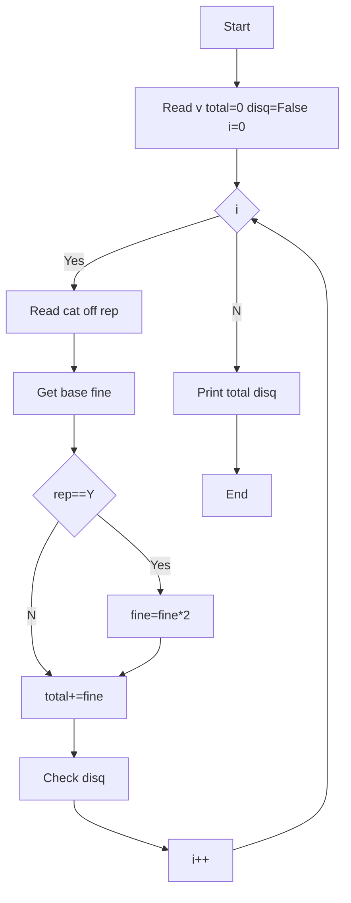

**Problem:** Fine by offence type, double if repeat, disqualify if >=3 or drunk.

**Algorithm:** 1.Read v 2.Get base fine 3.If rep Y double 4.Sum 5.Check disq

**Flowchart:**

Sample Input 1:
2
4W
speed
N
2W
signal
Y

Sample Output 1:
4000
False

Sample Input 2 (Disqualify):
3
4W
drunk
N
2W
speed
Y
4W
signal
N

Sample Output 2:
8500
True
