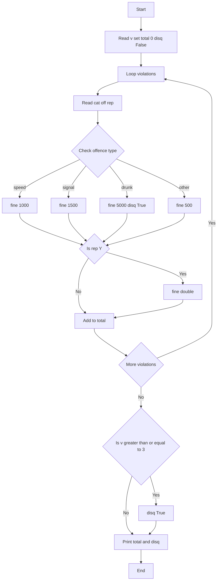

## Problem Statement
Given number of violations v, for each violation read category, offence type and whether it is repeat offence.
Fine rules:
- speed -> 1000
- signal -> 1500
- drunk -> 5000 and license disqualified
- others -> 500
If repeat is Y, fine is doubled.
If total violations >= 3, license is disqualified.

## Algorithm
1. START
2. Read v
3. Set total = 0, disq = False
4. Loop i from 0 to v-1
5.   Read cat, off, rep
6.   IF off == speed THEN fine = 1000
7.   ELSE IF off == signal THEN fine = 1500
8.   ELSE IF off == drunk THEN fine = 5000 and disq = True
9.   ELSE fine = 500
10.  IF rep == Y THEN fine = fine * 2
11.  total = total + fine
12. End Loop
13. IF v >= 3 THEN disq = True
14. Print total
15. Print disq
16. END

## Flowchart


## Sample Input and Output

**Input 1:**
```
2
car
speed
N
bike
signal
Y
```

**Output 1:**
```
4000
False
```

**Input 2:**
```
3
car
drunk
N
bike
speed
N
auto
signal
N
```

**Output 2:**
```
7500
True
```
