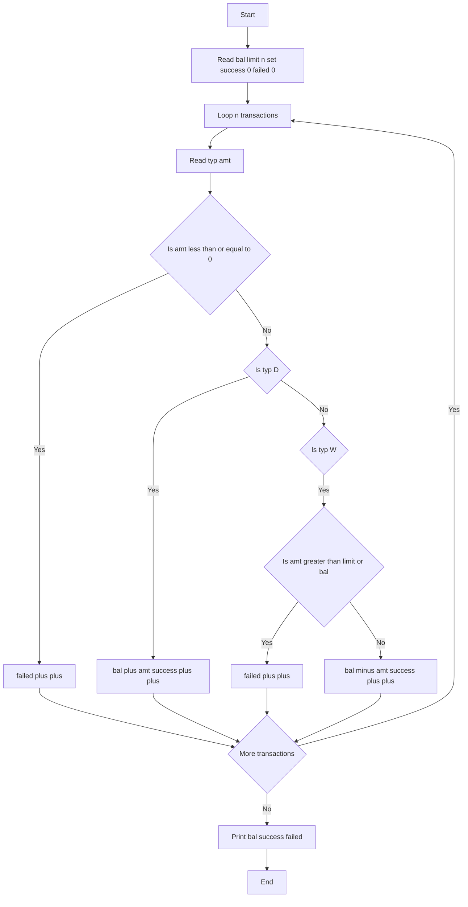

## Problem Statement
Given initial balance, withdrawal limit per transaction, and number of transactions n.
For each transaction read type and amount.
- If amount <= 0, failed++
- If type D, add amount to balance, success++
- If type W, check if amount > limit or amount > balance then failed++, else subtract amount, success++
Print final balance, success count, failed count.

## Algorithm
1. START
2. Read bal, limit, n
3. Set success = 0, failed = 0
4. Loop n times
5.   Read typ and amt
6.   IF amt <= 0 THEN failed++ and continue
7.   IF typ == D THEN bal = bal + amt, success++
8.   ELSE IF typ == W THEN
9. ELSE bal = bal - amt, success++
10. End Loop
11. Print bal
12. Print success
13. Print failed
14. END

## Flowchart


## Sample Input and Output

**Input 1:**
```
5000
2000
4
D 1000
W 1500
W 3000
W 500
```

**Output 1:**
```
4000
3
1
```

**Input 2:**
```
1000
500
3
W 600
D -100
W 400
```

**Output 2:**
```
600
1
2
```


