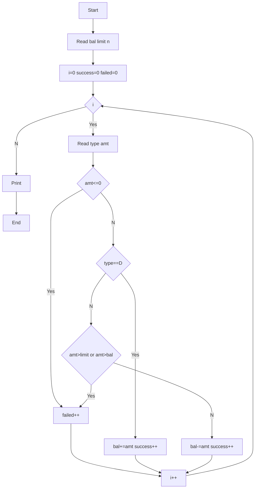

**Problem:** Process deposits and withdrawals with limit and balance check.

**Algorithm:**
1. Read bal, limit, n
2. Loop n times read type amt
3. If amt<=0 failed++
4. D->bal+=amt W->check limit & bal

**Flowchart:**

Sample Input 1:
5000
2000
4
D 1000
W 3000
W 1500
W 500

Sample Output 1:
4000
3
1
