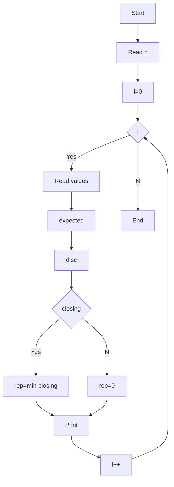

**Problem:** expected=opening+incoming-dispatched, check discrepancy and replenishment.

**Algorithm:** 1.Read p 2.expected calc 3.disc=closing-expected 4.rep=min-closing if needed

**Flowchart:**

Sample Input 1:
2
Pen
100
50
30
110
120
Book
200
100
250
60
100

Sample Output 1:
Pen 120 -10 10
Book 50 10 40
