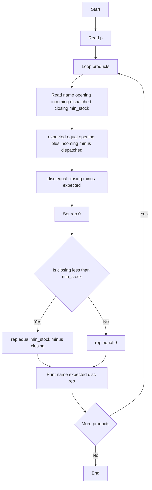

## Problem Statement
Given number of products p, for each product read name, opening stock, incoming stock, dispatched stock, closing stock and minimum stock required.
Calculate:
- expected = opening + incoming - dispatched
- discrepancy = closing - expected
- replenishment = 0 if closing >= min_stock else min_stock - closing
Print name, expected, discrepancy, replenishment.

## Algorithm
1. START
2. Read p
3. Loop i from 0 to p-1
4.   Read name, opening, incoming, dispatched, closing, min_stock
5.   expected = opening + incoming - dispatched
6.   disc = closing - expected
7.   Set rep = 0
8.   IF closing < min_stock THEN rep = min_stock - closing
9.   Print name, expected, disc, rep
10. End Loop
11. END

## Flowchart


## Sample Input and Output

**Input 1:**
```
2
Laptop
50
20
30
35
40
Mobile
100
50
20
120
100
```

**Output 1:**
```
Laptop 40 -5 5
Mobile 130 -10 0
```

**Input 2:**
```
1
Books
20
10
5
25
30
```

**Output 2:**
```
Books 25 0 5
```
