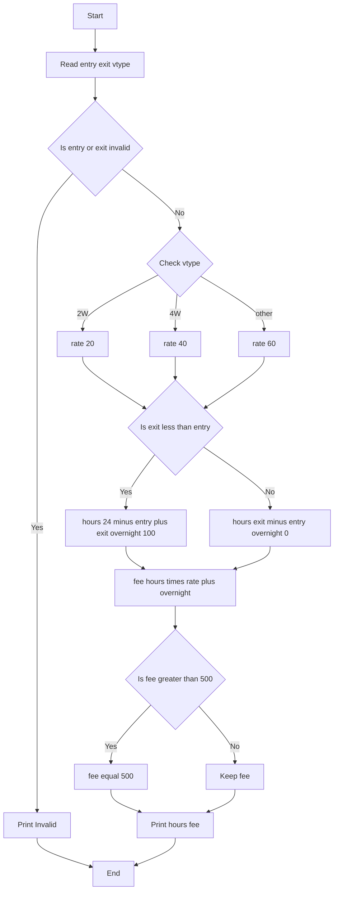

## Problem Statement
Given entry hour, exit hour (0-23) and vehicle type.
- If entry or exit invalid (not in 0-23), print Invalid
- Rates: 2W -> 20, 4W -> 40, others -> 60 per hour
- If exit < entry, it is overnight: hours = (24-entry)+exit, overnight charge = 100
- Else hours = exit-entry, overnight = 0
- fee = hours*rate + overnight
- If fee > 500, cap fee to 500
Print hours and fee.

## Algorithm
1. START
2. Read entry, exit_, vtype
3. IF entry < 0 OR entry > 23 OR exit_ < 0 OR exit_ > 23 THEN
4.   Print Invalid
5. ELSE
6.   IF vtype == 2W THEN rate = 20
7.   ELSE IF vtype == 4W THEN rate = 40
8.   ELSE rate = 60
9.   IF exit_ < entry THEN
10.    hours = (24 - entry) + exit_
11.    overnight = 100
12.  ELSE
13.    hours = exit_ - entry
14.    overnight = 0
15.  fee = hours * rate + overnight
16.  IF fee > 500 THEN fee = 500
17.  Print hours
18.  Print fee
19. END

## Flowchart


## Sample Input and Output

**Input 1:**
```
9
15
4W
```

**Output 1:**
```
6
240
```

**Input 2:**
```
22
3
2W
```

**Output 2:**
```
5
200
```

**Input 3:**
```
25
10
2W
```

**Output 3:**
```
Invalid
```
