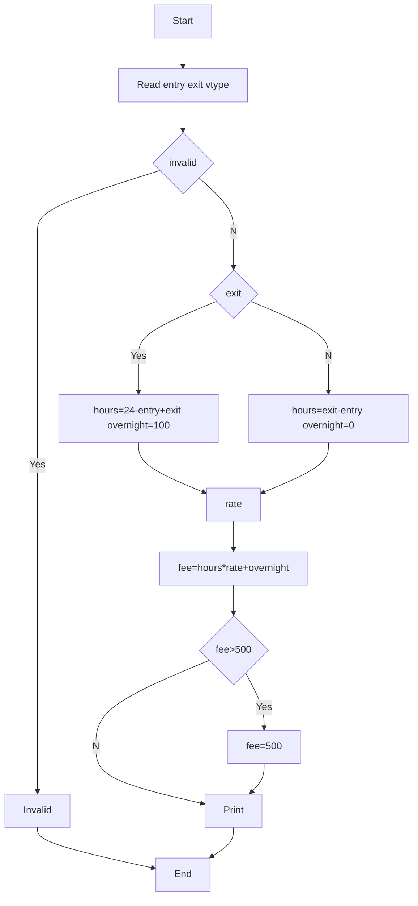

**Problem:** Calculate hours from entry exit, rate by vehicle, overnight charge, cap.

**Algorithm:** 1.Validate time 2.If exit<entry hours=24-entry+exit else exit-entry 3.fee=hours*rate+overnight 4.cap 500

**Flowchart:**

Sample Input 1:
9
15
4W

Sample Output 1:
6
240

Sample Input 2 (Overnight):
20
5
2W

Sample Output 2:
9
280
