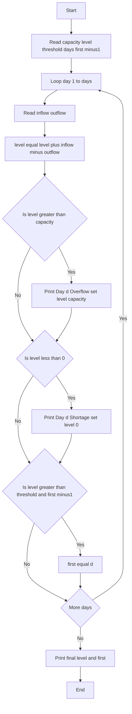

## Problem Statement
Given capacity, initial level, threshold and number of days.
For each day read inflow and outflow.
Update level = level + inflow - outflow.
- If level > capacity, print Day d Overflow and set level = capacity
- If level < 0, print Day d Shortage and set level = 0
- Track first day when level >= threshold
Finally print final level and first day (or -1 if never reached).

## Algorithm
1. START
2. Read capacity, level, threshold, days
3. Set first = -1
4. Loop d from 1 to days
5.   Read inflow, outflow
6.   level = level + inflow - outflow
7.   IF level > capacity THEN Print Day d Overflow, level = capacity
8.   IF level < 0 THEN Print Day d Shortage, level = 0
9.   IF level >= threshold AND first == -1 THEN first = d
10. End Loop
11. Print level
12. Print first
13. END

## Flowchart


## Sample Input and Output

**Input 1:**
```
100
50
80
3
30
10
20
5
10
60
```

**Output 1:**
```
Day 3 Overflow
100
2
```

**Input 2:**
```
50
10
30
2
5
5
10
20
```

**Output 2:**
```
Day 2 Shortage
0
-1
```
 

