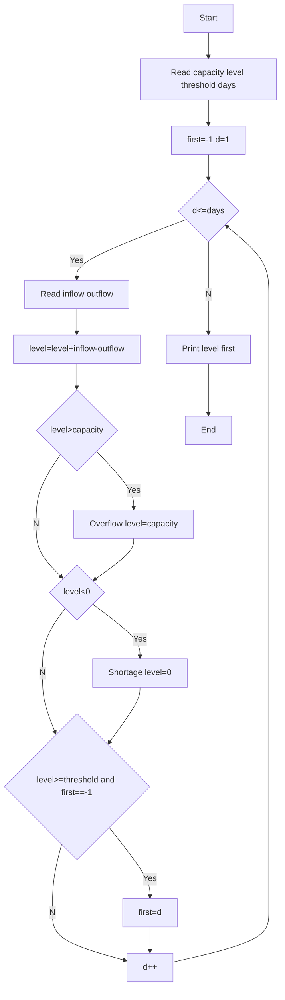

**Problem:** Update level, detect overflow shortage, first day reaching threshold.

**Algorithm:** 1.Read capacity level threshold days 2.Loop update level 3.Check overflow shortage 4.Track first threshold

**Flowchart:**

Sample Input 1:
1000
200
600
3
500
100
300
200
100
300

Sample Output 1:
Day 1 Overflow
400
1

Sample Input 2:
1000
200
600
2
500
100
300
200

Sample Output 2:
600
2
