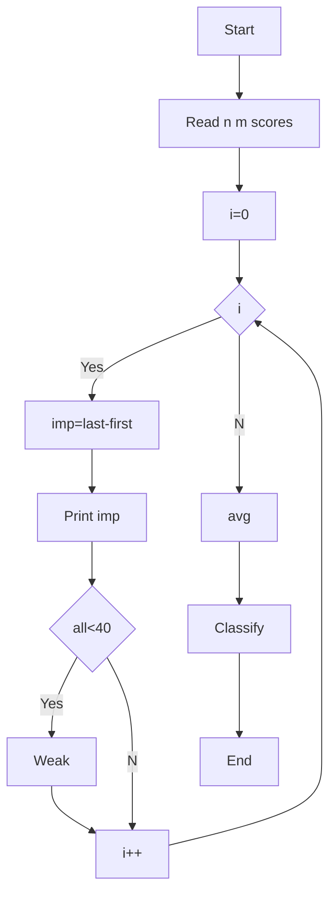

**Problem:** Compare scores, improvement, weak subjects, classify.

**Algorithm:** 1.Read n m 2.Read matrix 3.imp=last-first 4.all<40 weak 5.avg classify

**Flowchart:**

Sample Input 1:
2
3
30 35 30
60 70 80

Sample Output 1:
0
Sub0 Weak
10
60.0
First
