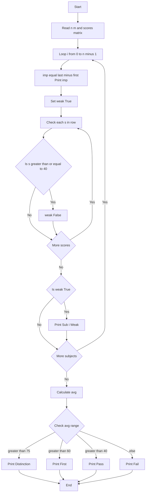

## Problem Statement
Given n subjects and m scores per subject (matrix).
For each subject row:
- improvement = last score - first score, print it
- If all scores in row < 40, print Sub i Weak
Calculate overall average = average of all row averages.
- avg >=75 -> Distinction
- avg >=60 -> First
- avg >=40 -> Pass
- else Fail

## Algorithm
1. START
2. Read n, m
3. Read matrix scores of size n x m
4. Loop i from 0 to n-1
5.   imp = scores[i][m-1] - scores[i][0], Print imp
6.   Set weak = True
7.   For each score s in scores[i]
8.     IF s >= 40 THEN weak = False
9.   IF weak == True THEN Print Sub i Weak
10. End Loop
11. avg = average of all scores
12. IF avg >= 75 THEN Print Distinction
13. ELSE IF avg >= 60 THEN Print First
14. ELSE IF avg >= 40 THEN Print Pass
15. ELSE Print Fail
16. END

## Flowchart


## Sample Input and Output

**Input 1:**
```
2
3
70 80 90
30 20 35
```

**Output 1:**
```
20
5
Sub1 Weak
Fail
```

**Input 2:**
```
1
4
60 70 80 90
```

**Output 2:**
```
30
First
```
