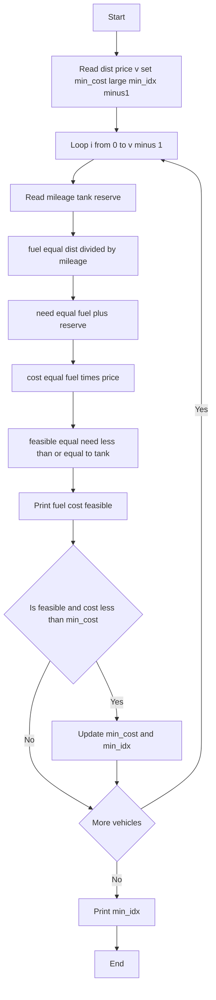

## Problem Statement
Given distance, fuel price, and number of vehicles v.
For each vehicle read mileage, tank capacity, reserve.
Calculate:
- fuel = dist / mileage
- need = fuel + reserve
- cost = fuel * price
- feasible = need <= tank
Print fuel, cost, feasible for each.
Find vehicle with minimum cost among feasible ones, print its index, else -1.

## Algorithm
1. START
2. Read dist, price, v
3. Set min_cost = large value, min_idx = -1
4. Loop i from 0 to v-1
5.   Read mileage, tank, reserve
6.   fuel = dist / mileage
7.   need = fuel + reserve
8.   cost = fuel * price
9.   feasible = need <= tank
10.  Print fuel, cost, feasible
11.  IF feasible AND cost < min_cost THEN min_cost = cost, min_idx = i
12. End Loop
13. Print min_idx
14. END

## Flowchart


## Sample Input and Output

**Input 1:**
```
100
100
2
50
10
2
25
10
1
```

**Output 1:**
```
2.00 200.00 True
4.00 400.00 True
0
```

**Input 2:**
```
200
90
1
10
15
10
```

**Output 2:**
```
20.00 1800.00 False
-1
```
