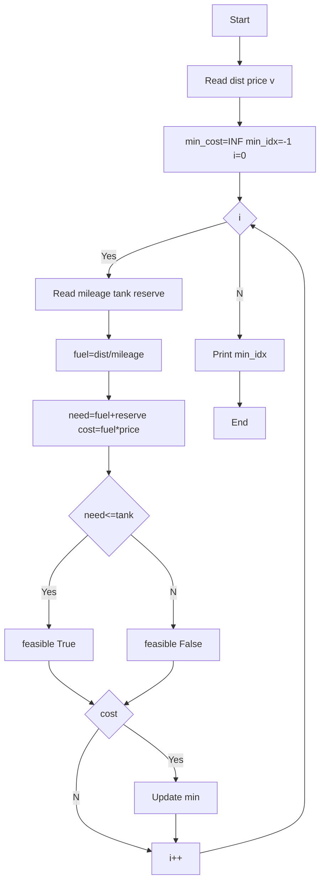

**Problem:** fuel=dist/mileage, cost=fuel*price, feasible check with reserve.

**Algorithm:** 1.Read dist price v 2.fuel calc 3.need=fuel+reserve 4.feasible=need<=tank 5.Track min cost

**Flowchart:**

Sample Input 1:
100
100
2
10
15
2
20
10
1

Sample Output 1:
10.00 1000.00 True
5.00 500.00 True
1
