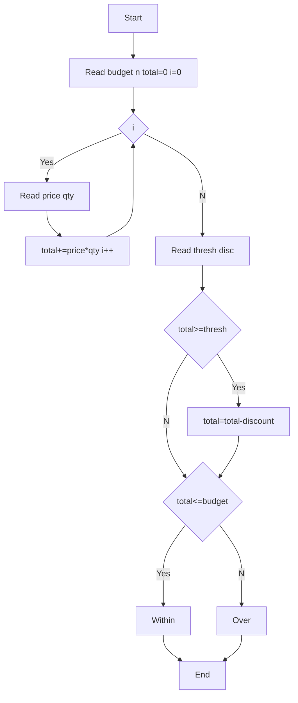

**Problem:** Sum basket, apply discount if >=thresh, check budget.

**Algorithm:** 1.Read budget n 2.Sum price*qty 3.If total>=thresh discount 4.Check budget

**Flowchart:**

Sample Input 1 (Within):
5000
2
1000
2
500
3
3000
10

Sample Output 1:
3150
Within Budget

Sample Input 2 (Over):
2000
2
1000
2
500
3
3000
10

Sample Output 2:
3150
Over Budget
1150
