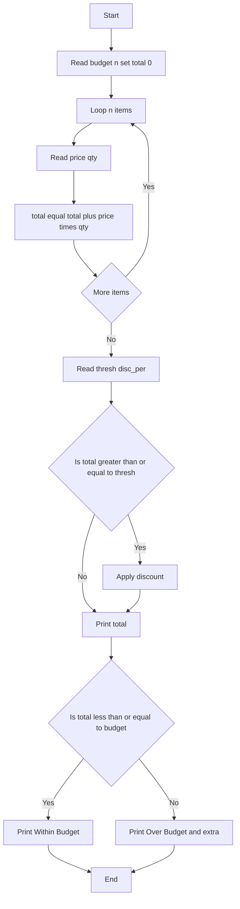

## Problem Statement
Given budget, number of items n, for each item price and quantity.
Calculate total = sum(price * qty).
Read threshold and discount percentage.
If total >= threshold, apply discount: total = total - total*disc_per/100.
Print total, then check budget:
- If total <= budget -> Within Budget
- Else Over Budget and print extra amount needed.

## Algorithm
1. START
2. Read budget, n
3. Set total = 0
4. Loop n times
5.   Read price, qty
6.   total = total + price * qty
7. End Loop
8. Read thresh, disc_per
9. IF total >= thresh THEN total = total - total*disc_per/100
10. Print total as int
11. IF total <= budget THEN Print Within Budget
12. ELSE Print Over Budget and Print total-budget
13. END

## Flowchart


## Sample Input and Output

**Input 1:**
```
1000
2
100
2
200
3
500
10
```

**Output 1:**
```
720
Within Budget
```

**Input 2:**
```
500
1
300
2
400
20
```

**Output 2:**
```
480
Within Budget
```

**Input 3:**
```
400
1
300
2
400
20
```

**Output 3:**
```
480
Over Budget
80
```

