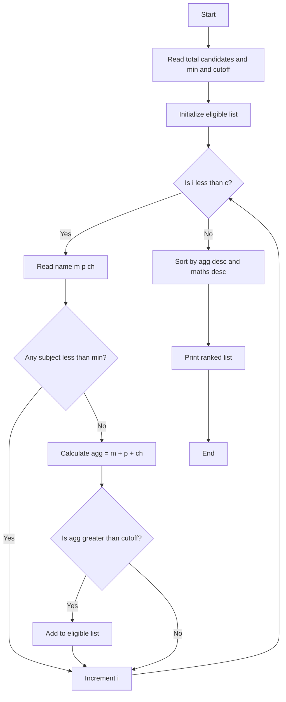

**Problem:** Check subject min, aggregate cutoff, rank with tie-break maths.

**Algorithm:** 1.Read c min cutoff 2.Check each subject>=min 3.agg>=cutoff eligible 4.Sort desc agg, maths

**Flowchart:**

Sample Input 1:
3
40
180
Aman
80
70
60
Riya
90
85
80
Karan
50
40
30

Sample Output 1:
Riya 255
Aman 210
