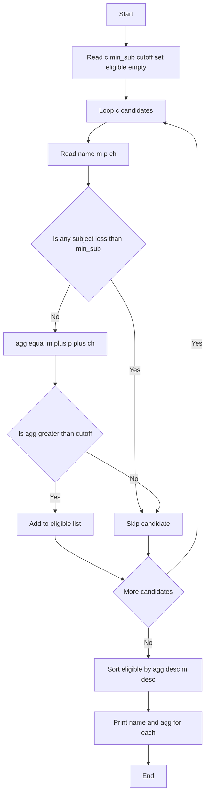

## Problem Statement
Given number of candidates c, minimum subject mark, and cutoff aggregate.
For each candidate read name, maths, physics, chemistry marks.
- If any subject < min_sub, not eligible
- Else aggregate = m+p+ch, if aggregate >= cutoff then eligible
Store as (name, aggregate, maths).
Sort eligible list by aggregate descending, then maths descending.
Print name and aggregate for each eligible.

## Algorithm
1. START
2. Read c, min_sub, cutoff
3. Set eligible = empty list
4. Loop c times
5.   Read name, m, p, ch
6.   IF m < min_sub OR p < min_sub OR ch < min_sub THEN continue
7.   agg = m + p + ch
8.   IF agg >= cutoff THEN append (name, agg, m) to eligible
9. End Loop
10. Sort eligible by -agg, then -m
11. For each e in eligible Print name and agg
12. END

## Flowchart


## Sample Input and Output

**Input 1:**
```
3
35
180
Ravi
80
70
60
Anu
90
80
70
Sai
30
80
80
```

**Output 1:**
```
Anu 240
Ravi 210
```

**Input 2:**
```
2
40
200
John
60
60
60
Doe
50
50
90
```

**Output 2:**
```
John 180
```
